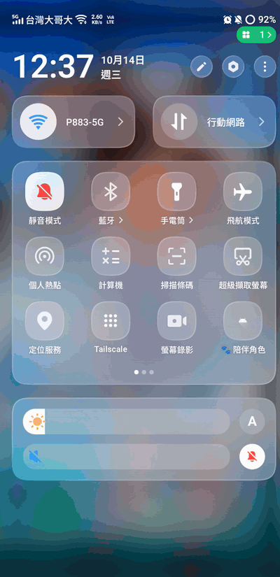
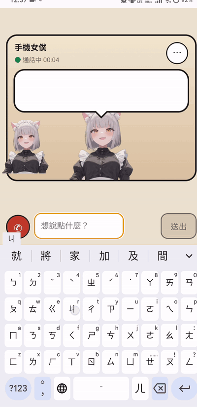
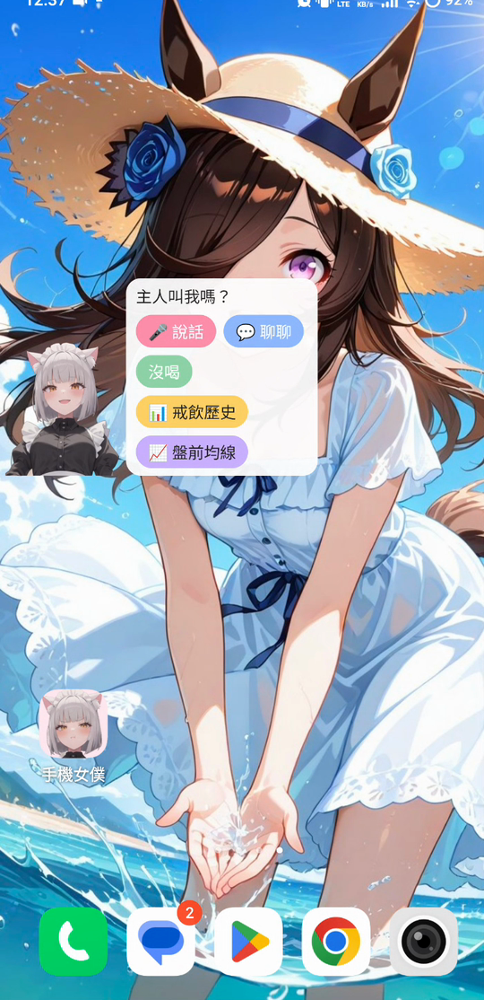
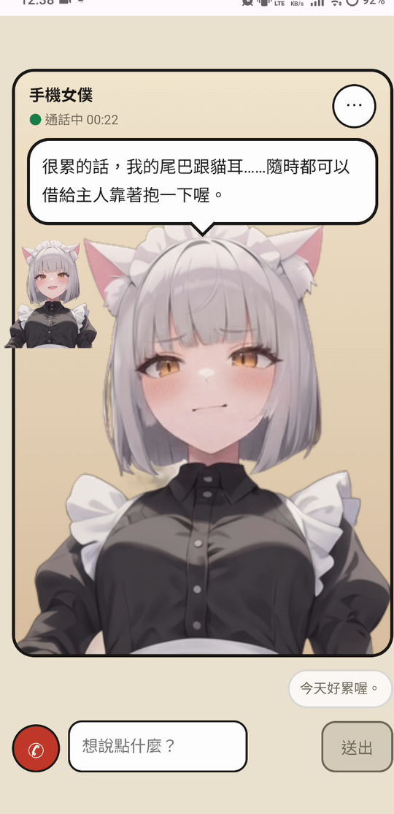
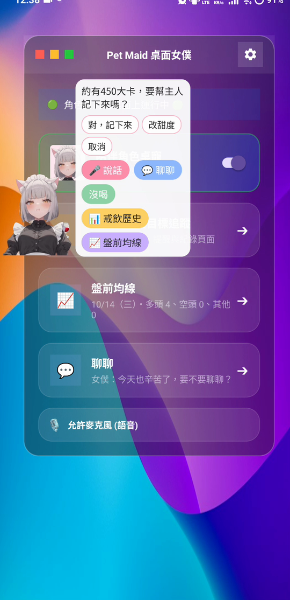
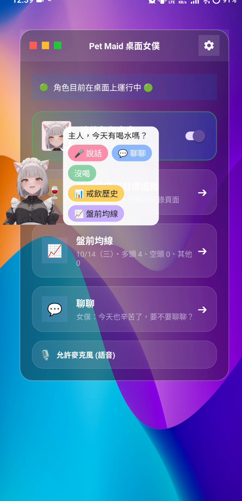

# AccompanyPet（桌面陪伴女僕）

會常駐在 Android 桌面、會動、可以點、可以聊天的陪伴角色。她會在需要時出現，用你設定的人設說話，並幫你處理幾件日常小事。

這個專案是對 [AI 願望池 wish-28「可愛細心的虛擬總管女僕助理」](https://yazelin.github.io/wish-pool/#wish-28) 的實作，目前是**第一版、單人使用**的狀態。

> 內附作者的貓娘女僕角色圖，**僅供瀏覽，不在 MIT 授權範圍內**，詳見 [ART-LICENSE.md](ART-LICENSE.md)。想換成自己的角色，見下方「自訂角色」。

## 展示

<p align="center">
  
</p>

<p align="center">
  
</p>

| 叫出角色 | 聊天 | 戒飲記錄 | 提醒 |
|---|---|---|---|
|  |  |  |  |

## 功能與完成度

對照願望 wish-28 列出的需求，誠實標示做到哪裡：

| 願望需求 | 狀態 | 說明 |
|---|---|---|
| 可愛的女僕形象 | ✅ 已完成 | 懸浮角色、整張表情差分、逐字說話、眨眼 |
| 文字／語音聊天陪伴 | ✅ 已完成 | 聊天頁為視訊通話風格；語音辨識由手機端處理 |
| 提醒 | ✅ 已完成 | 伺服器經 FCM 推播，角色出現並說話；玩遊戲時先排隊不出聲 |
| 日常事務（戒飲記錄） | ✅ 已完成 | 口說飲料 → 複述確認 → 寫入並算熱量；每天依設定時段詢問；不需要的人可在「戒飲設定」關閉（啟用戒飲記錄） |
| 日常事務（盤前均線） | ✅ 已完成 | 每個交易日開盤前，報告追蹤標的的均線排列，可管理追蹤清單、回看近 7 日 |
| 使用者介面可自訂外觀與語氣 | ✅ 已完成 | 聊天頁選單「✎ 小檔案」可直接編輯人設（稱呼、語氣、禁止事項），存檔前檢查必要章節與字數，可一鍵還原預設；「上傳／更換背景圖」可自訂聊天背景 |
| 待辦清單管理 | 🟡 部分 | 串接 Todoist：依任務類型催進度、到期當天提醒；不能在 App 內新增任務 |
| 微調設定介面 | 🟡 部分 | 有人設編輯、背景圖、戒飲詢問時段設定畫面；其他設定（追蹤標的預設值、台詞檔等）仍需改 `backend/config/` 並重新部署 |
| 行事曆管理 | ❌ 未做 | 規格中列為「之後再說」 |
| 訊息自動回覆 | ❌ 未做 | |
| 購物清單與購物提醒 | ❌ 未做 | |
| 多平台同步（手機與電腦） | ❌ 未做 | 目前只有 Android；資料集中在 Cloudflare D1，電腦端沒有專用介面 |

已知限制：
- 只支援**單一使用者、單一手機**：伺服器只存一組推播裝置代碼與一把存取密鑰。
- 部分手機廠牌（例如 vivo）會凍結背景 App 並移除鬧鐘，定時巡邏無效，只能靠快速設定磚手動叫回角色。詳見 [BLOCKERS.md](BLOCKERS.md)。
- 從懸浮窗啟動麥克風受 Android 14 以上背景限制，需實機確認。

## 架構

```
Android App（Kotlin） ── 懸浮窗服務 + 透明 WebView（角色）
   │                    └ 聊天頁 / 盤前均線頁（WebView，只載入你設定的 https 網址）
   │
   ├── FCM 推播 ◄────────── Cloudflare Worker（backend/）
   │                         ├ 聊天、人設、表情標籤、語言模型呼叫
   │                         ├ 排程：盤前均線、飲料詢問、Todoist 掃描
   │                         └ D1 資料庫（唯一資料來源）
   └── core/：不依賴 Android 的純 Kotlin 邏輯（推播解析、路由、排隊、判斷）
```

- `app/`：Android 殼，負責服務、視窗、權限、推播接收。
- `core/`：純 Kotlin 邏輯與規格測試。
- `backend/`：Cloudflare Worker、聊天網頁、設定檔與 JS 測試。
- `docs/`：設定教學、架構、各里程碑計畫書。完整架構見 [docs/ARCHITECTURE.md](docs/ARCHITECTURE.md)，產品規格見 [docs/wish28-pet-spec.md](docs/wish28-pet-spec.md)。

App 只有 `WorkerApi.kt` 可以連外；網頁呼叫原生的介面（`@JavascriptInterface`）固定 6 個，由驗收腳本檢查。

## 我可以直接用嗎？

目前**沒有提供現成的 APK**。這個 App 需要連到「你自己的」推播與聊天伺服器才能完整運作，而這些連線設定會在建置時寫進 App，所以一份預先建好的 APK 沒辦法通用。

好消息是：伺服器部分用的都是免費額度，自己架一次大約 30 到 60 分鐘，而且可以請 AI 代理人（例如 Claude Code）照著文件幫你做。

## 開始之前，你需要準備

| 項目 | 用途 | 費用 |
|---|---|---|
| Android 手機（Android 8.0 以上） | 執行 App | — |
| Windows、macOS 或 Linux 電腦 | 建置 App、部署伺服器 | — |
| Google 帳號 | Firebase 推播、取得 Gemini 金鑰 | 免費 |
| Cloudflare 帳號 | 架設聊天與提醒伺服器 | 免費額度即可 |
| Gemini API 金鑰 | 讓角色說話 | 有免費額度，依用量計費 |
| （可選）Todoist 帳號 | 使用待辦提醒 | 免費版即可 |

## 安裝方式

### 方式一：請 AI 代理人幫你做（建議）

1. 在電腦上安裝 [Claude Code](https://claude.com/claude-code) 或其他能讀檔、執行指令的 AI 代理人。
2. 下載（clone）這個專案，用代理人開啟專案資料夾。
3. 對它說：

   > 請讀 `docs/AGENT-SETUP.md`，照著幫我完成建置與設定。需要我登入帳號或貼金鑰時再告訴我。

代理人會自己檢查環境、建置 App、部署伺服器，遇到必須由你本人操作的步驟（登入 Firebase、Cloudflare、貼上金鑰）會停下來請你處理。

### 方式二：自己動手

1. 照 [docs/FIREBASE-SETUP.md](docs/FIREBASE-SETUP.md) 設定推播。
2. 照 [docs/WORKER-SETUP.md](docs/WORKER-SETUP.md) 部署伺服器。
3. 用 Android Studio 開啟專案，接上手機按 ▶，或執行 `./gradlew assembleDebug` 後安裝 `app/build/outputs/apk/debug/app-debug.apk`。

## 第一次使用

1. 打開 App，依畫面提示授予**顯示在其他應用程式上層**、**通知**與**麥克風**權限。
2. 若要讓角色在你玩遊戲時先不出聲，另外授予**使用情形存取權**。
3. 下拉手機的快速設定面板，編輯並加入「🐾 陪伴角色」磚。點一下就能叫出或收起角色。
4. 點角色會展開泡泡：
   - **聊聊**：開啟視訊風格的聊天畫面，第一次需要輸入你設定的存取密鑰。
   - **說話**：用語音記錄一杯飲料。
5. 主畫面有兩張卡片：「盤前均線」查看報告、「聊聊」進入聊天。

## 日常功能

- **提醒**：伺服器依排程推播，角色會出現並說話。你正在玩遊戲時，提醒會先排隊，通知欄只放一則靜音的「有 N 則提醒等你」。
- **戒飲記錄**：對角色說「剛喝了一杯大杯珍奶半糖」，她會複述確認，再幫你記錄並算熱量。每天會在你設定的時間問你有沒有喝。不想用的話，到「戒飲設定」把「啟用戒飲記錄」關掉，就不會再被詢問，角色泡泡上的相關按鈕也會消失，過去的資料不會被刪除。
- **Todoist 待辦**：串接後，擱置太久的任務會催你，到了可以開始做的那天會提醒。
- **盤前均線**：每個交易日早上 8:30 左右，報告你追蹤標的的均線排列。**僅供參考，不構成投資建議。**

## 自訂角色

- **語氣與人設**：聊天畫面選單的「✎ 小檔案」可以直接改稱呼、語氣與禁止事項，存檔後立刻生效，隨時可還原預設。
- **聊天背景**：同一個選單的「上傳背景圖」、「更換背景圖」。
- **角色圖**：專案內附作者的角色圖。要換成自己的，同檔名覆蓋即可：
  - 懸浮窗：`app/src/main/assets/pet/frames/local/`（`idle.png`、`blink.png`，另有 `smile`、`pout`、`shy`、`thinking`、`troubled`），重新建置 App。
  - 聊天畫面：`backend/assets/character/frames/`（同樣七張，300×349），重新部署後端。格式見 `backend/config/emotion-map.json`。
  - 換圖後請勿把我的角色圖與你的混用發布，也請遵守 ART-LICENSE.md。

## 常見問題

**收不到提醒？**
- 確認 App 主畫面有顯示「推播代碼」，而且這串代碼已設定到伺服器（`FCM_DEVICE_TOKEN`）。重裝 App 或清除資料後代碼會變，要重設。
- 部分手機（例如 vivo）會凍結背景 App，造成提醒延遲或失效，請把 App 加入電池最佳化白名單；仍不行時只能用快速設定磚手動叫出角色。

**點「聊聊」顯示尚未設定？**
`worker.properties` 的 `chatUrl` 沒填或不是 `https://` 開頭。填好後要重新建置並安裝。

**聊天一直連線失敗？**
通常是 App 與伺服器的存取密鑰不一致，或 Gemini 金鑰有問題。可以請代理人依 `docs/AGENT-SETUP.md` 的「疑難排解」逐項檢查。

**角色圖顯示不出來？**
確認 `app/src/main/assets/pet/frames/local/` 與 `backend/assets/character/frames/` 的檔名沒有改，且 App 與後端都已重新建置、部署。

## 隱私與權限

- App 會要求：顯示在其他應用程式上層（顯示角色）、通知、麥克風（語音辨識）、使用情形存取權（可選，只在收到提醒的當下讀一次前景 App，判斷你是否在玩遊戲，不常駐監看）。
- 聊天內容與記錄只會送到**你自己部署**的 Cloudflare 伺服器，再由它轉給 Gemini。專案作者不會收到任何資料。
- 金鑰與設定檔（`firebase.properties`、`worker.properties`、`google-services.json` 等）都在 `.gitignore` 內，請勿自行提交。

## 已知限制

- 只支援單一使用者、單一手機。
- 只有 Android 版。
- 懸浮窗啟動麥克風受 Android 14 以上的背景限制，部分機型需先打開 App 再說話。

## 專案文件導覽

根目錄與 `docs/` 有很多文件。一般使用者只需要看前兩列，其餘是開發過程紀錄。

| 類別 | 檔案 | 給誰看 |
|---|---|---|
| 使用與授權 | `README.md`、`LICENSE`、`ART-LICENSE.md` | 所有人 |
| 安裝設定 | `docs/AGENT-SETUP.md`（給 AI 代理人）、`docs/FIREBASE-SETUP.md`、`docs/WORKER-SETUP.md` | 要自己建置的人 |
| 架構與規格 | `docs/ARCHITECTURE.md`、`docs/wish28-pet-spec.md`、`docs/DEVELOPMENT.md` | 開發者 |
| 開發過程紀錄 | `ACCEPTANCE-*.md`（各里程碑的驗收結果）、`DEVICE-CHECKLIST-*.md`（手機實測清單）、`PROGRESS.md`、`DECISIONS.md`、`BLOCKERS.md`、`CHECKLIST.md` | 想了解測試與決策過程的人 |
| 品質報告 | `SPEC-MAP.md`、`RISK-REVIEW.md`、`MUTATION-REPORT.md`、`SECURITY-REPORT.md` | 想了解測試覆蓋與風險的人 |
| 計畫書 | `docs/M*-CHEAP-PLAN.md`、`docs/M*-EXPENSIVE-PLAN.md`、`docs/M*-T*.md`、`lanes/` | 想看 AI 代理人怎麼分階段開發的人 |
| 設計原型 | `design/prototype/` | 想看畫面設計的人 |

- 檔名裡的 `M0`、`M1.5`、`M4.4` 是開發里程碑編號，不是版本號。
- 開發過程紀錄與品質報告是這個專案「由 AI 代理人開發、以自動驗收把關」的證據。`verify.sh` 的部分檢查會讀取它們，所以不要單獨刪除。
- 這些紀錄可能含作者的本機路徑與手機型號，不含任何金鑰。

測試、驗收腳本與開發流程見 [docs/DEVELOPMENT.md](docs/DEVELOPMENT.md)；完整架構見 [docs/ARCHITECTURE.md](docs/ARCHITECTURE.md)；產品規格見 [docs/wish28-pet-spec.md](docs/wish28-pet-spec.md)。

## 授權

程式碼採 [MIT 授權](LICENSE)。角色圖片與由它產生的 App 圖示、表情圖**不在 MIT 授權範圍內**，條款見 [ART-LICENSE.md](ART-LICENSE.md)。
