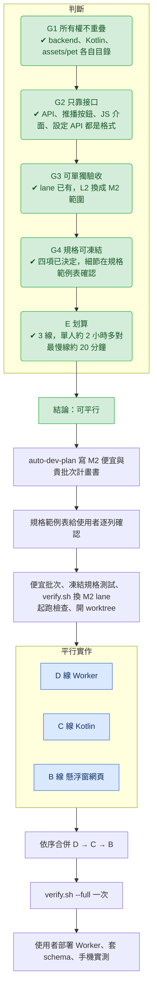

# M2 交接文件：戒飲記錄（F1）平行開工

> 2026-10-05 由規劃 session 寫成。新 session 只要附上這份文件，就能從 §6 第 1 步開始往下做。
> 平行判斷用 parallel-lanes skill，結論：**可平行（B、C、D 三條線）**。
> 背景文件：`docs/wish28-pet-spec.md` §4 F1、§5 M2；做法沿用 `docs/PARALLEL-AGENTS.md`；計畫書格式照 `docs/M1.6-EXPENSIVE-PLAN.md`。

## 1. 使用者已拍板的決定（2026-10-05）

| # | 問題 | 決定 | 理由與影響 |
|---|---|---|---|
| ① | 戒飲存（`ml_demo/cost_down`）有沒有寫入 API | **沒有**。M2 寫入 pet-maid 自己的 D1，**欄位照戒飲存備份檔的格式**，之後可以匯出給戒飲存匯入（選項 c） | 戒飲存是 Netlify 上的純靜態 PWA，資料只存在瀏覽器 localStorage（鍵 `boba_ai_tracker`），只能用匯出／匯入 JSON 搬資料 |
| ② | 熱量怎麼算 | **改用戒飲存的組合式模型**，不另外建「品項 → 熱量」表 | LLM 只負責把口語對應到固定清單的編號，數字一律由模型算。戒飲存的「Gemini 代打估熱量」**不搬**，因為規格禁止 LLM 估熱量 |
| ③ | 回本 % 的參數 | **在 App 裡做設定畫面**，可以設定月費、忍住一杯的入帳金額、每月額度。角色的「沒喝」**等於**戒飲存的「忍住」 | 設定值存在 D1，Worker 算統計和排程時都會讀到 |
| ④ | App 呼叫 Worker API 的驗證 | **沿用同一把 `APP_SECRET`** | Worker 已經用 `x-app-secret` 標頭比對，不用改 Worker 驗證；App 端在 `worker.properties` 加 `apiSecret`，建置時寫進 BuildConfig |

## 2. 從戒飲存搬過來的東西（已查證，路徑以 `ml_demo/cost_down/netlify_deploy/` 為根）

| 項目 | 來源 | 內容摘要 |
|---|---|---|
| 熱量模型資料 | `data/drink-model.json` | 容量 M／L／XL（係數 0.71／1.0／1.29）；糖度 full／less／half／quarter／none（係數 1／0.7／0.5／0.3／0）；基底 7 種；配料十幾種；以 700ml 全糖 = 240 kcal 為基準 |
| 熱量計算 | `core/calorie.js` | 糖 = 240 × 糖度係數 × 容量係數；基底 = 基底值 × 容量係數；配料**不隨容量縮放**；加總後四捨五入到 10；總和大於 0 時最少 10 kcal。冰量不影響熱量。查不到容量或糖度時係數用 1（寧可高估） |
| 星巴克查表 | `data/starbucks.json`、`calorie.js` 的 `lookupTableKcal` | 官方公告值；仍是 `<TODO:...>` 佔位的列不採用 |
| 統計 | `core/ledger.js`、`index.html` 第 456–469 行 | 省錢帳只算 `price > 0`；熱量帳算全部喝了的紀錄（含請客）；**省下杯數 = min(本月忍住次數, max(0, 每月額度 − 本月喝了杯數))**；賺回金額 = 省下杯數 × 入帳金額；回本 % = min(100, round(賺回 ÷ 月費 × 100))，每月重新計算 |
| 時段 | `core/slots.js` | `morning` 10:00、`lunch` 12:00、`afternoon` 14:00、`dinner` 19:00、`latenight` 20:00 |
| 預設值 | `index.html` 第 387–395 行 | 訂閱 `Claude Pro`、月費 650、入帳金額 60、每月額度 20 |
| 備份檔格式 | `index.html` 的 `exportData` | 整個 `data` 物件：`{ subscription:{name, monthlyFee}, monthlyQuota, resistValue, drinks:[...], logs:[...] }` |
| 紀錄格式 | `docs/DESIGN-v2.md`、`index.html` 的 `saveEntry` | 喝了：`{date, slot, type:'drink', drinkId:null, name, price, kcal, source, ice}`；忍住：`{date, slot, type:'resist'}`。`source` 用 `model`／`table`。**kcal 不得是 0 或 null** |

搬法：`drink-model.json`、`starbucks.json` 複製到 `backend/config/`；`calorie.js`、`ledger.js` 的純函式複製到 `backend/core/` 並附來源 commit（`cost_down` 的 `9fc08b2`），寫法比照 `backend/SOURCE.md`。

## 3. 條件檢查（套用 §1 的決定後）

| 條件 | 結果 | 依據 |
|---|---|---|
| G1 檔案所有權不重疊 | ✔ | 見 §4。`index.html` 歸 B，`MainActivity`、`OverlayService`、`PetBridge` 歸 C，`backend/**` 歸 D。`verify.sh` 和共用文件歸規劃者 |
| G2 只靠事先寫死的接口 | ✔ | 依賴的都是格式（§5）。D1 schema 只有 D 線用；設定值經過 API 傳遞，C 線不碰 D1 |
| G3 每條線能單獨驗收 | ✔（前置要補） | `verify.sh --lane B\|C\|D` 已經有了，但 L2 對應的是 M1.6 的規格列，要換成 M2 的 |
| G4 規格能先凍結 | ✔（前置要補） | ①–④ 都已決定；剩下 §7 的細節在規格範例表那一步一起確認。LLM 口語解析準不準只能手機實測；自動驗收只凍結「拿固定的解析結果去算熱量、統計、決定要不要請使用者選品項」這段規則 |
| E1 線數 2 到 4 | ✔ | 3 條 |
| E2 省下的時間大於成本 | ✔ | 單人依序做約 2–2.5 小時（③ 多了設定畫面和 API），最慢的 D 線估 15–25 分鐘。準備腳本和 `--lane` 已有，前置主要花在計畫書和凍結規格 |
| E3 邊界自然 | ✔ | Worker JS、Kotlin、網頁三種技術，各自在不同目錄 |



## 4. 分線與檔案所有權

| 線 | 負責 | 擁有的檔案 | 合併順序 |
|---|---|---|---|
| **D Worker** | 口語解析（LLM 只輸出編號）、熱量計算、查不到時給候選清單、寫入喝了與忍住、撤銷、統計、設定讀寫、匯出成戒飲存備份格式、每天詢問的排程推播、人設台詞（數字不能被改動） | `backend/**`（含 `wrangler.toml` 加排程觸發、`worker/schema.sql` 加表、`config/` 放模型資料） | 1 |
| **C Kotlin** | 語音辨識出文字後送 Worker；把結果交給網頁；網頁按鈕回送 Worker；通知按鈕「沒喝」「有喝，用說的」；App 主畫面的戒飲設定畫面；`apiSecret` 建置欄位 | `app/src/main/java/**`、`app/src/main/res/**`、`core/**`、`app/build.gradle.kts`、`worker.properties.example` | 2 |
| **B 懸浮窗網頁** | 複述泡泡和「對，記下來／改甜度／取消」；改甜度時顯示 5 個糖度選項；候選品項清單；泡泡上的「沒喝」；等待 Worker 回應時顯示思考貌 | `app/src/main/assets/pet/**` | 3 |
| 規劃者 | 計畫書、便宜批次、`verify.sh`、`tools/prepare-worktree.sh`、PROGRESS、DECISIONS、ACCEPTANCE、RISK-REVIEW、`docs/wish28-pet-spec.md` | — | — |

各線只寫自己的 `lanes/M2-<線>.md`。

## 5. 接口草案（寫進貴批次計畫書 §4 時定案）

以下是規劃 session 的提案。計畫書可以改，但定案後三條線只靠這一節溝通。

### 5.1 HTTP API（D 提供、C 呼叫；一律帶 `x-app-secret`）

| 方法與路徑 | 送出 | 回應 |
|---|---|---|
| `POST /api/drink/parse` | `{ text, draft? }`（`draft` 不為空表示在修改上一筆草稿） | `{ kind:'confirm', draft, kcal, script }` 或 `{ kind:'choose', candidates:[{baseId, name}], draft, script }` 或 `{ kind:'other', script }` |
| `POST /api/drink/confirm` | `{ draft }` | `{ logId, stats, script }` |
| `POST /api/drink/resist` | `{}` | `{ logId, stats, script }` |
| `POST /api/drink/undo` | `{ logId }` | `{ ok, script }` |
| `GET /api/drink/stats` | — | `stats`：`{ weekCups, monthSavedMoney, paybackPct, monthSavedKcal, ... }` |
| `GET` 和 `PUT /api/drink/settings` | `{ subscriptionName, monthlyFee, resistValue, monthlyQuota, askTime }` | 同左 |
| `GET /api/drink/export` | — | 戒飲存備份格式的 JSON（§2） |

- `draft` 的格式是 `{ name, baseId, sizeId, sugarLevelId, ice, toppingIds[], price? }`，所有編號都要對應 `drink-model.json`。不在清單上的編號，Worker 一律當成「查不到」，回 `kind:'choose'`，**不估數字**。
- 「改甜度」不重新呼叫 LLM：網頁顯示 5 個糖度選項，選完由 C 線帶著改好的 `draft` 呼叫 `confirm`。修改流程不需要 Worker 保存對話狀態。
- `script` 是帶表情標籤的台詞，格式和 M1.6 推播的 `script` 一樣。台詞裡的數字必須和規則算出來的數字一致；不一致時重試一次，還是不一致就改用預設台詞（比照 M1.5 的 `fallback-lines.json`）。

### 5.2 推播（D 送出、C 解析）

沿用 M1.6 的 `{ id, text, script? }`，再加 `actions?: [{ id, label }]`。每天詢問的推播帶 `[{id:'resist', label:'沒喝'}, {id:'speak', label:'有喝，用說的'}]`。

### 5.3 JS 介面（B 提供 `window.pet.*`、C 提供 `PetBridge.on*`）

- C 呼叫 B：`window.pet.thinking(true|false)`，以及 `window.pet.showDrink(json)`。`json` 就是 parse、confirm、resist 的回應原文。B 依 `kind` 顯示複述、候選清單，或直接演出 `script`（沿用 `window.pet.say`）。
- B 呼叫 C：`PetBridge.onDrinkAction(json)`。`json` 是 `{ action:'confirm'|'cancel'|'setSugar'|'choose'|'resist'|'undo', draft?, sugarLevelId?, baseId?, logId? }`。
- 沒有對應的橋接方法時，沿用 M1.5 決定 47 的做法：`callBridge` 略過，不出錯。

### 5.4 D1（只有 D 線使用）

- 新表 `drink_logs`：`id, date, slot, type, name, price, kcal, source, ice, size_id, sugar_level_id, base_id, topping_ids, created_at, undone`。匯出時轉成戒飲存的紀錄格式，`drinkId` 一律填 `null`。
- 設定值存在既有的 `settings` 表，鍵名用 `drink.` 開頭。
- 每天詢問：排程觸發固定每小時跑一次，依台北時間比對 `drink.askTime`（預設 `15:00`）。用 D1 記錄當天送過沒有，一天最多送一次。

## 6. 新 session 照這個順序做

1. **讀**這份文件、`docs/PARALLEL-AGENTS.md`、`docs/M1.6-EXPENSIVE-PLAN.md`（格式範本）、`docs/wish28-pet-spec.md` §4 F1 與 §5 M2。
2. **問使用者怎麼處理未追蹤的 `.idea/` 和 `tools/push.json`**：要 commit、加進 `.gitignore`，還是不動。只有已 commit 的內容會進 worktree，不要擅自 commit。
3. **用 auto-dev-plan 寫** `docs/M2-CHEAP-PLAN.md` 和 `docs/M2-EXPENSIVE-PLAN.md`。章節照 M1.6：§0 執行協定（含 `--lane`）、§1 所有權（照本文件 §4）、§4 接口（照本文件 §5 定案）、§4.5 規格範例表、§7 預設值表、§9 回報格式。
4. **把規格範例表和 §7 的待決定事項交給使用者逐列確認，在這裡停下來等回覆。** 沒確認完不往下做。
5. **跑便宜批次**：搬戒飲存的模型資料與來源說明、`worker.properties.example` 加 `apiSecret` 說明、`DEVICE-CHECKLIST-M2.md`、CHECKLIST 加「套用新 schema、填 `apiSecret`、重新部署 Worker」。
6. **凍結規格測試**：放在 `backend/tests/spec/m2/` 和 `core/src/test/.../spec/`。凍結前先寫草稿實作，確認測試能被滿足，再刪掉草稿。
7. **改 `verify.sh` 的 lane**：L2 換成 M2 範圍。D 跑 backend 測試（含 `spec/m2`）；C 跑 `:core:test` 和 `:app:compileDebugKotlin`；B 跑網頁相關測試。含反斜線的內容一律用 Write／Edit 寫，寫完用 `LC_ALL=C grep -nP '[\x00-\x08]' verify.sh` 檢查。
8. **起跑檢查**：在 master 分別跑 `./verify.sh --lane B`、`--lane C`、`--lane D`。每條線都應該只卡在自己還沒實作的規格列；如果是腳本本身出錯，先修腳本。
9. **commit**，然後開 worktree，每條線都跑一次準備腳本：
   ```bash
   git worktree add -b m2-lane-d ../pet-maid-m2-d && bash tools/prepare-worktree.sh ../pet-maid-m2-d
   ```
   C、B 線照做（Git Bash，在主倉庫根目錄執行）。開完確認 worktree 的 `worker.properties` 裡有 `apiSecret`。準備腳本不會覆蓋已存在的檔案，所以主倉庫的 `worker.properties` 要先填好 `apiSecret` 再開 worktree。
10. **派工**：三個代理人在背景同時跑，訊息用 §8 的範本。
11. **整合**：依 D → C → B 的順序 `--no-ff` 合併 → 處理各線的「需要整合處理」→ `./verify.sh --full` 跑一次 → 寫 ACCEPTANCE-M2、RISK-REVIEW、PROGRESS → 移除 worktree 和分支。
12. **交給使用者**：套用 schema、`wrangler deploy`（密鑰相關一律用 Git Bash 或 cmd，見 `docs/WORKER-SETUP.md`），再照 DEVICE-CHECKLIST-M2 手機實測。實測後調整過的規格要重新凍結。
13. **更新 `docs/PARALLEL-AGENTS.md`**：寫進 M2 的實際數字和新踩到的坑。

## 7. 待決定（在第 4 步的規格範例表一起確認）

| 事項 | 規劃 session 的建議 | 為什麼要決定 |
|---|---|---|
| 價格 | 使用者有說價格（例如「65 塊」）才記；沒說就存 `null`，複述時不追問 | 戒飲存把 `price` 是 0 或沒填當成「別人請客」，匯出 `null` 到戒飲存會被算成請客 |
| 時段 | 依按下時的台北時間，對應到最接近的戒飲存時段 | 戒飲存每筆紀錄都要有 `slot` |
| 「沒喝」一天能按幾次 | 一天一次；同一天再按就回覆「今天已經記過了」 | 戒飲存是每個時段各能記一次，規格寫的是一天一鍵 |
| 撤銷 | 撤銷最近一筆，在泡泡上保留 1 分鐘 | 規格寫「沒喝」可以撤銷，但沒寫怎麼撤銷 |
| 匯出按鈕 | M2 只做 `GET /api/drink/export`，App 的匯出按鈕留到之後 | 決定 ① 寫的是「之後可以匯出」 |
| 「說話」按鈕的範圍 | M2 期間，按「說話」說的內容一律送 `parse`；跟飲料無關時回 `kind:'other'`，用人設回一句話 | 目前「說話」只把辨識出的文字顯示在泡泡上 |
| 回報內容 | 規格四項：本週杯數、本月省下金額、回本 %、少攝取熱量 | 確認回報時要不要再加別的數字 |

## 8. 派工訊息範本

```
你是 M2 的 <D|C|B> 線（負責：<§4 的一句話>）。
工作目錄：<worktree 絕對路徑>（只在這裡工作）。
先讀 docs/M2-EXPENSIVE-PLAN.md 的 §0 執行協定、§1 檔案所有權、§4 接口、§4.5 本線規格列、§9 回報格式。
驗收只跑 ./verify.sh --lane <線>；只在分支 m2-lane-<線> commit。
程式碼檔一律用 Write／Edit 寫，不用 shell heredoc。
碰到別線的檔案或 verify.sh 本身有問題時不要改，寫進 lanes/M2-<線>.md 的「需要整合處理」。
完成或卡住時，照 §9 格式回報。
```

## 9. 已知的坑（摘自 `docs/PARALLEL-AGENTS.md` §6）

- 含反斜線的內容一律用檔案工具寫，不用 heredoc（M1.6 的 `\1` 和 `\n` 都在這裡出過事）。
- `npm install` 要加 `--no-package-lock`，準備腳本已經處理。
- Windows 上送密鑰或含 emoji 的內容，不要用 PowerShell 5.1 的管線，改用 Git Bash 或 cmd。
- 驗收腳本新增的檢查，起跑前要用會觸發它的輸入實際跑過一次。
