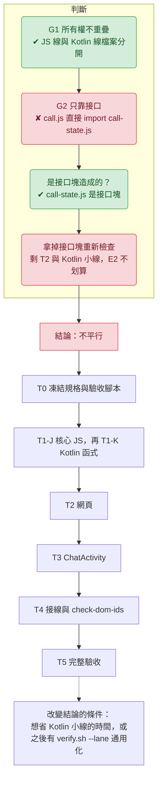

# M4.2 平行分線判斷（2026-10-11）

> 依 parallel-lanes 技能判斷。**結論：不平行（單人依序 T0 → T1 → T2 → T3 → T4 → T5）。** 唯一值得考慮的選配是把 Kotlin 小線（T1-K＋T3）另開一條，見下方「選配」。階段摘要：docs/M4.2-T0.md ～ M4.2-T5.md。

## 工作塊

| 工作塊 | 會改的檔案 | 依賴 | 單人預估 |
|---|---|---|---|
| T0 凍結規格與驗收腳本 | spec 測試 2 檔、`verify.sh`、SPEC-MAP.md | 便宜批次 | 中 |
| T1-J JS 核心 | `call-state.js`、`blink.js`、`emotion-map.json`、輔助測試 2 檔 | T0 | 中偏大 |
| T1-K Kotlin 函式 | `Chat.kt`、`ChatExitHelperTest.kt` | T0 | 小 |
| T2 網頁 | `index.html`、`style.css`、`app.js`、`renderer.js`、`call.js`、`manifest`、刪 3 檔、`call-wiring.test.js` | T1-J 的匯出 | 大 |
| T3 ChatActivity | `ChatActivity.kt` | T1-K 的 `isChatExitUrl` | 小 |
| T4 接線 | `check-dom-ids.mjs`、`verify.sh`、對齊修正 | T2、T3 全部 | 小到中 |
| T5 完整驗收 | 報告檔 | T4 | 中（含 Gradle 與突變測試） |

## 條件檢查

| 條件 | 結果 | 依據 |
|---|---|---|
| G1 檔案所有權不重疊 | ✔ | JS 線（T1-J、T2）與 Kotlin 線（T1-K、T3）檔案完全分開；`verify.sh`、spec、報告檔歸規劃者或 T0／T4／T5 |
| G2 只靠事先寫死的接口 | ✘（部分） | T2 的 `call.js` 直接 import `call-state.js`，依賴的是「別塊寫出來的程式碼」；若把 T1-J 當接口塊，T2 才能開工 |
| G3 每塊可單獨驗收 | ✘ | `verify.sh --lane` 只有 B、C、D（M1.6 到 M4 的測試集），M4.2 的 lane 要另外加；T2 的 W-A 測試需要 T1-J 完成 |
| G4 規格可凍結 | ✔ | 15 列範例表已確認，T0 轉測試 |
| E1 能分 2 到 4 條 | 勉強 | 實際只有 2 條（JS 線、Kotlin 線），而 JS 線內部是序列 |
| E2 省下的時間大於前置加整合 | ✘ | Kotlin 線只有一個函式加一處攔截，扣掉 worktree 準備、`--lane` 擴充與合併，省不到什麼；JS 線最慢且無法再拆 |
| E3 邊界自然 | ✔ | JS 與 Kotlin 本來就分屬不同技術 |

## 選配：Kotlin 小線（只有想省時間才用）

T0 完成並 commit 後，另開 worktree 派一個代理人做 **K 線 = T1-K ＋ T3**（`Chat.kt`、`ChatExitHelperTest.kt`、`ChatActivity.kt`），主線繼續做 T1-J → T2。K 線完成後先合併，再進 T4。

| 項目 | 內容 |
|---|---|
| 檔案所有權 | K 線：`Chat.kt`、`ChatActivity.kt`、`helper/ChatExitHelperTest.kt`；主線：其他全部 |
| 接口 | `CHAT_EXIT_URL = "chat-exit://close"`、`fun isChatExitUrl(url: String?): Boolean`（計畫書 §4.4.1，已寫死） |
| lane 驗收 | 要在 `verify.sh` 加 K 線：L1 全跑，L2 只跑 `./gradlew :core:test` 與 `:app:compileDebugKotlin`、V53（目前沒有，T0 時順手加） |
| 合併順序 | K → 主線，再 T4 |
| 風險 | `verify.sh` 同時被主線與 K 線需要，所有權歸規劃者，各線不得修改；M4 的教訓：T0 沒做完不可派工 |

不選配時，T3 的 `docs/M4.2-T3.md` 照序列執行即可，內容不變。

## 改變結論的條件

- `verify.sh --lane` 改成可傳任意測試集，前置成本大降時，Kotlin 小線的成本才夠低。
- 若之後再加一條與網頁無關的 Kotlin 工作（例如 App 端名稱更名），Kotlin 線的分量變大，才值得固定拆線。
